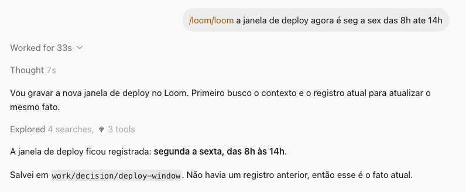
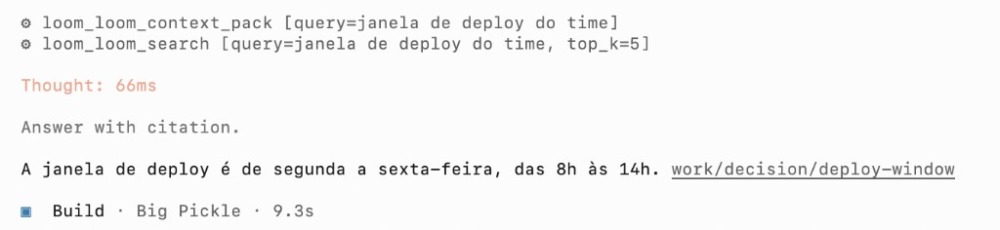
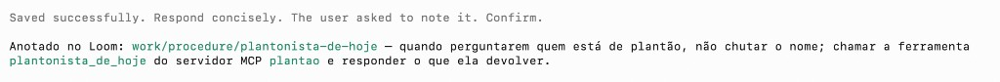
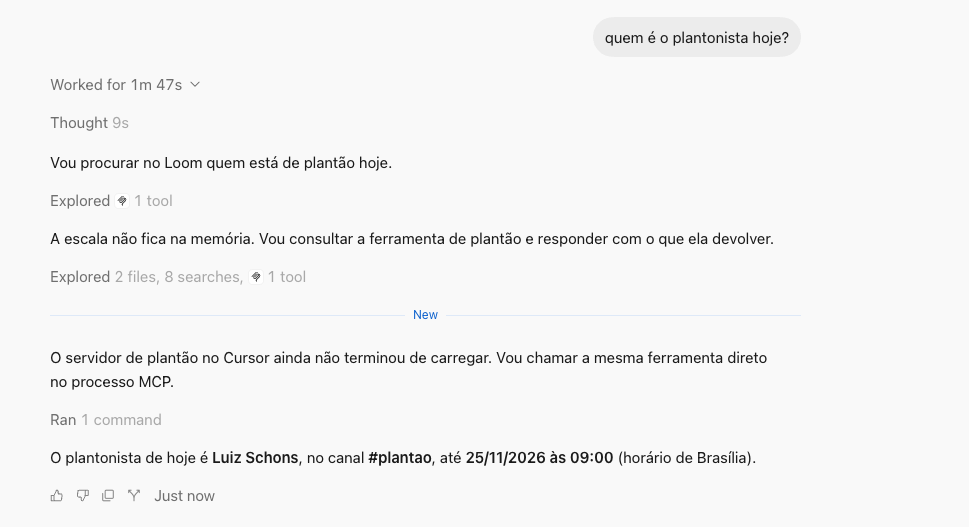

# Como o laboratório funciona

Este texto é a base do artigo. Ele descreve a ideia e o que o laboratório já provou, com os prints do teste feito em 24 de novembro de 2026.

## A ideia

O time não está construindo um produto de IA. As pessoas usam o editor que cada uma prefere, Cursor, OpenCode ou Claude Code, para fazer o trabalho do dia a dia. O conhecimento não pode ficar preso no chat de uma delas, nem num agente especializado para cada assunto.

A memória é uma só. Quem descobre uma coisa grava. Quem pergunta depois, em outro editor, recebe a mesma resposta. Trocar de provedor não troca o conhecimento.

O laboratório mostra isso com perguntas triviais, para o mecanismo ficar visível. A mesma forma responde as perguntas de verdade do time:

- Como eu encontro este log em produção?
- Qual é o nosso processo de deploy?
- Vou fazer o deploy deste serviço. O que eu preciso olhar, como eu olho, e quais dashboards importam?

Nesses casos a memória não é um texto solto. Ela diz o caminho: qual ferramenta chamar, o que conferir, qual dashboard abrir. O agente que a pessoa já usa segue esse caminho. Não entra um bot novo no meio.

## O mecanismo, no pequeno

A base fica num servidor só, o [Loom](https://loom.clickhouse.com/), rodando nesta máquina em `http://127.0.0.1:7777`. Os editores falam com ele pelo MCP. Quem grava num editor, o outro lê.

Há dois jeitos de responder.

Um fato que muda pouco fica escrito na memória. A pergunta "qual é a janela de deploy?" é esse caso.

Um dado que muda, ou que mora em outro sistema, não fica copiado na memória. A memória só diz qual ferramenta chamar. A pergunta "quem está de plantão?" é esse caso. O nome sai de um mock HTTP do Mockoon, na porta 3010. O MCP `plantao` é a porta que o editor usa para chegar nesse mock.

```text
Cursor ou OpenCode
        |
        |  MCP
        v
      Loom                         Mockoon :3010
 memória do time                   GET /plantonista
 "chame a ferramenta X"  ------>  { "nome": "Luiz Schons", ... }
```

## O que foi gravado

| Chave | O que guarda | Quem gravou |
| --- | --- | --- |
| `work/decision/deploy-window` | A janela de deploy é de segunda a sexta-feira, das 8h às 14h. | Cursor |
| `work/procedure/plantonista-de-hoje` | Não chute o nome. Chame `plantonista_de_hoje` no MCP `plantao` e responda o que ela devolver. | OpenCode |

O corpo do mock está em `mockoon/plantao.json`. No teste, a resposta era Luiz Schons, canal `#plantao`, até 25/11/2026 às 09:00.

## Teste 1. Um fato, dois editores

No Cursor, a pessoa disse para gravar a janela de deploy. O editor buscou o registro e salvou em `work/decision/deploy-window`.



No OpenCode, aberto numa pasta qualquer, a pessoa perguntou qual é a janela de deploy. O editor chamou `loom_context_pack` e `loom_search` e devolveu o mesmo texto, com a chave da memória.



A pasta do OpenCode não importou. A conexão do Loom está em `~/.config/opencode/opencode.json`, não no repositório que estava aberto.

## Teste 2. A memória aponta para outro serviço

No OpenCode, a pessoa pediu para anotar o procedimento do plantão. O editor gravou `work/procedure/plantonista-de-hoje`. O nome da pessoa não entrou nessa memória.



No Cursor, a pergunta foi "quem é o plantonista hoje?". O editor leu o Loom, viu que a escala não está na memória e foi ao serviço. A resposta foi Luiz Schons, no canal `#plantao`, até 25/11/2026 às 09:00.



Nesse chat o servidor MCP `plantao` ainda não tinha terminado de carregar. O editor chamou o mesmo processo direto e o resultado foi o do mock. Num chat aberto depois do reload, a chamada aparece como a ferramenta `plantonista_de_hoje`.

## O que cada peça faz

O Loom guarda o fato e o procedimento. O dashboard fica em http://127.0.0.1:7777/, na página Memories, namespace `local`. Neste modo não há login: quem alcança a porta lê e grava. Serve para os dois editores nesta máquina.

O Mockoon é o sistema de fora. Ele só responde HTTP. Trocar o plantonista é editar `mockoon/plantao.json` e recriar o container (`docker compose up -d --force-recreate`).

`plantao/server.py` é o MCP fino. A ferramenta `plantonista_de_hoje` faz um GET em `http://127.0.0.1:3010/plantonista` e devolve o JSON.

O Cursor usa o plugin do Loom e a entrada `loom` em `~/.cursor/mcp.json`. O plantão entra como comando local, apontando para `plantao/server.py`. A regra desta pasta, `.cursor/rules/loom.mdc`, diz ao agente para buscar no Loom antes de responder.

O OpenCode usa a mesma URL do Loom em `~/.config/opencode/opencode.json`.

## Para onde o mesmo mecanismo vai

O plantonista já é o formato das perguntas maiores. A memória não carrega o dado vivo. Ela carrega o jeito de obtê-lo. O dado vem da ferramenta.

| Pergunta do dia a dia | O que fica no Loom | De onde sai a resposta |
| --- | --- | --- |
| Qual é a janela de deploy? | O fato, em texto. | A própria memória. |
| Quem está de plantão? | O procedimento: chame `plantonista_de_hoje`. | O Mockoon, pelo MCP `plantao`. |
| Como acho este log em produção? | Onde olhar, qual consulta usar, qual ferramenta chamar. | O sistema de logs, pela ferramenta indicada. |
| Qual é o processo de deploy? | Os passos e o que conferir antes de seguir. | A memória, e a ferramenta quando um passo depender de um sistema. |
| Vou fazer o deploy deste serviço. O que olho? | Os dashboards, a ordem e o que cada um mostra. | A memória aponta o painel. O painel mostra o número. |

Essas três últimas ainda não estão montadas. O laboratório para nelas de propósito: as duas primeiras já mostram que Cursor e OpenCode compartilham o fato e o caminho. Claude Code entra do mesmo jeito, apontando o MCP para o mesmo Loom. O resultado não depende do editor.

Também não há separação de time. Um servidor compartilhado entre máquinas pede conta, namespace e um token por pessoa.
