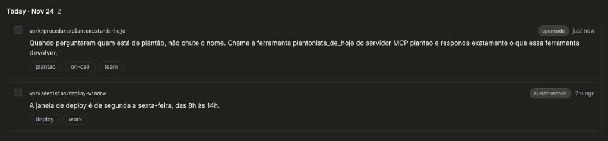
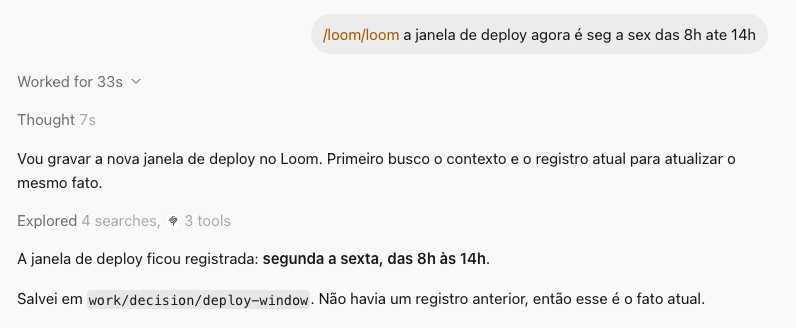
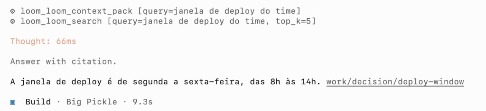
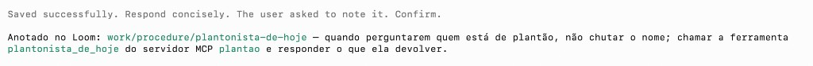
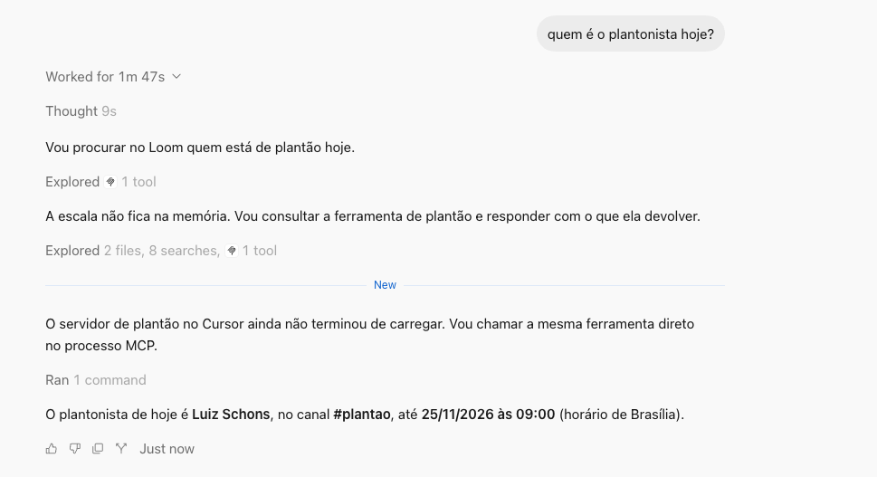

# How the lab works

This is the base for the article. It states the idea and what the lab already proved, with the screenshots from the test on 24 November 2026.

The chats that produced the screenshots were in Portuguese. Quoted lines below are the original text. The English beside them is the translation.

## The idea

The team is not building an AI product. People use whichever editor they prefer, Cursor, OpenCode, or Claude Code, for everyday work. Knowledge should not stay trapped in one person's chat, and it should not require a specialist agent per topic.

There is one memory. Whoever figures something out writes it. Whoever asks later, in another editor, gets the same answer. Switching providers does not switch the knowledge.

The lab shows this with trivial questions, so the mechanism stays visible. The same shape answers the team's real questions:

- How do I find this production log?
- What is our deploy process?
- I am deploying this service. What do I need to look at, how do I look, and which dashboards matter?

In those cases the memory is not a loose paragraph. It stores the path: which tool to call, what to check, which dashboard to open. The agent the person already uses follows that path. No new bot sits in the middle.

## The mechanism, at a small scale

The base is one server, [Loom](https://loom.clickhouse.com/), running on this machine at `http://127.0.0.1:7777`. The editors talk to it over MCP. What one editor writes, the other reads.

There are two ways to answer.

A fact that rarely changes is written into memory. "What is the deploy window?" is that case.

A value that changes, or that lives in another system, is not copied into memory. Memory only says which tool to call. "Who is on call?" is that case. The name comes from an HTTP mock in Mockoon, on port 3010. The `plantao` MCP is the door the editor uses to reach that mock.

```text
Cursor or OpenCode
        |
        |  MCP
        v
      Loom                         Mockoon :3010
 team memory                       GET /plantonista
 "call tool X"            ------>  { "nome": "Luiz Schons", ... }
```

## What was stored

| Key | What it stores | Who wrote it |
| --- | --- | --- |
| `work/decision/deploy-window` | The deploy window is Monday to Friday, 8:00 to 14:00. Original: "A janela de deploy é de segunda a sexta-feira, das 8h às 14h." | Cursor |
| `work/procedure/plantonista-de-hoje` | Do not guess the name. Call `plantonista_de_hoje` on the `plantao` MCP and answer with whatever it returns. | OpenCode |

The Memories page shows both records on 24 November 2026. OpenCode wrote the on-call procedure. Cursor wrote the deploy window. The stored text is still the Portuguese from the chats.



The mock body is in `mockoon/plantao.json`. During the test the response was Luiz Schons, channel `#plantao`, until 25 November 2026 at 09:00.

## Test 1. One fact, two editors

In Cursor, the person asked to save the deploy window. The editor looked up the record and saved it at `work/decision/deploy-window`.



In OpenCode, opened in an arbitrary folder, the person asked what the deploy window is. The editor called `loom_context_pack` and `loom_search` and returned the same text, with the memory key.



The OpenCode folder did not matter. The Loom connection lives in `~/.config/opencode/opencode.json`, not in the repository that was open.

## Test 2. Memory points at another service

In OpenCode, the person asked to note the on-call procedure. The editor saved `work/procedure/plantonista-de-hoje`. The person's name did not go into that memory.



In Cursor, the question was "quem é o plantonista hoje?" ("who is on call today?"). The editor read Loom, saw that the roster is not in memory, and went to the service. The answer was Luiz Schons, on channel `#plantao`, until 25 November 2026 at 09:00.



In that chat the `plantao` MCP server had not finished loading. The editor called the same process directly and the result was the mock's. In a chat opened after a reload, the call shows up as the tool `plantonista_de_hoje`.

## What each piece does

Loom stores the fact and the procedure. The dashboard is at http://127.0.0.1:7777/, on the Memories page, namespace `local`. In this mode there is no login: anyone who can reach the port can read and write. It is enough for two editors on this machine.

Mockoon is the outside system. It only answers HTTP. Changing who is on call means editing `mockoon/plantao.json` and recreating the container (`docker compose up -d --force-recreate`).

`plantao/server.py` is the thin MCP. The tool `plantonista_de_hoje` sends a GET to `http://127.0.0.1:3010/plantonista` and returns the JSON. The JSON fields stay `nome`, `canal`, and `ate`, which is what the mock returned in the test.

Cursor uses the Loom plugin and the `loom` entry in `~/.cursor/mcp.json`. On-call is a local command pointing at `plantao/server.py`. The rule for this folder, `.cursor/rules/loom.mdc`, tells the agent to look in Loom before answering.

OpenCode uses the same Loom URL in `~/.config/opencode/opencode.json`.

## Where the same mechanism goes

The on-call question is already the shape of the larger questions. Memory does not carry the live value. It carries how to get it. The value comes from the tool.

| Everyday question | What stays in Loom | Where the answer comes from |
| --- | --- | --- |
| What is the deploy window? | The fact, as text. | The memory itself. |
| Who is on call? | The procedure: call `plantonista_de_hoje`. | Mockoon, through the `plantao` MCP. |
| How do I find this production log? | Where to look, which query to use, which tool to call. | The log system, through the tool named in memory. |
| What is the deploy process? | The steps and what to check before continuing. | Memory, and a tool when a step depends on another system. |
| I am deploying this service. What do I look at? | The dashboards, the order, and what each one shows. | Memory points at the dashboard. The dashboard shows the number. |

The last three are not built. The lab stops there on purpose: the first two already show that Cursor and OpenCode share the fact and the path. Claude Code joins the same way, by pointing its MCP config at the same Loom. The result does not depend on the editor. Claude Code was not part of this test.

There is also no team separation. A server shared across machines needs an account, a namespace, and a token per person.
